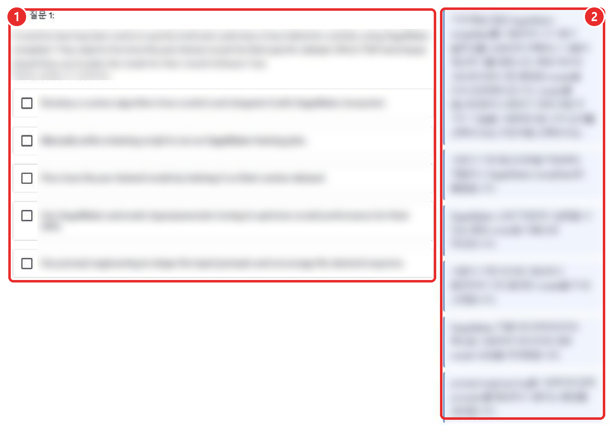
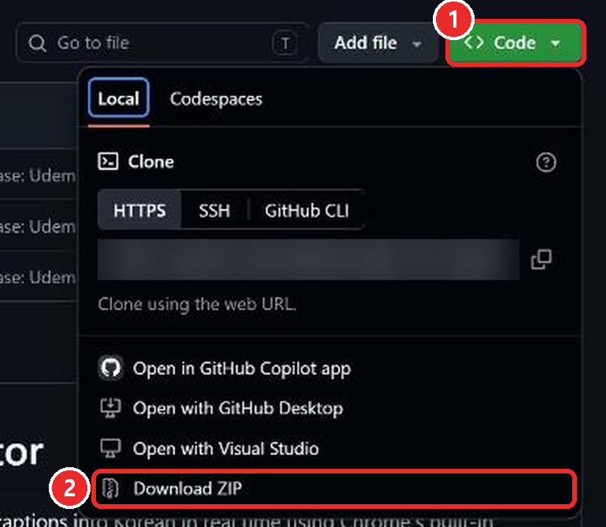
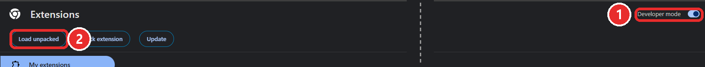
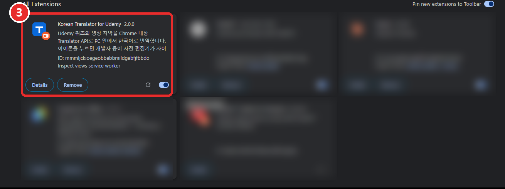
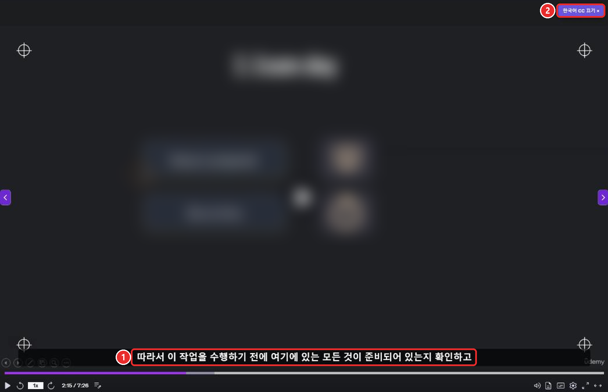

# Korean Translator for Udemy

Udemy를 한국어로 보여 주는 Chrome 확장 프로그램입니다.

- **퀴즈와 시험**: 영어 문제와 보기 옆에 한국어 번역이 나옵니다.
- **강의 영상**: 영어 자막이 한국어 자막으로 바뀝니다.

번역은 내 컴퓨터 안에서 이루어집니다. 최초 단어장 동기화와 Chrome 번역 모델 다운로드가 끝나면 서버 연결 없이 사용할 수 있습니다. 단어장 업로드에는 기존 플랫폼 계정과 등록 권한이 필요하며, 별도 도우미 프로그램은 필요 없습니다.

**①** 원래 영어 문제와 보기 · **②** 한국어 번역 (그림의 강의 내용은 흐리게 처리했습니다)

---

## Requirements

- 컴퓨터용 **Chrome** 브라우저 (최신 버전)
- **Udemy** 계정과 수강 중인 강의
- 최초 단어장 동기화와 번역 모델 다운로드를 위한 인터넷 연결
- (선택) 서버 업로드에 사용할 **플랫폼 계정과 등록 권한**. 로컬 편집과 번역에는 로그인이 필요 없습니다.

> Chrome이 최신인지 확인하려면: Chrome 오른쪽 위 **⋮** → **도움말** → **Chrome 정보**를 누르세요. 업데이트가 있으면 자동으로 설치됩니다.

---

## Installation

### Download Files

1. 이 페이지 위쪽의 초록색 **Code** 버튼을 누릅니다. **①**
2. 아래에 나오는 **Download ZIP**을 누릅니다. **②**
3. 내려받은 ZIP 파일을 마우스 오른쪽 버튼으로 누르고 **압축 풀기**(모두 압축 풀기)를 선택합니다.
4. 압축을 푼 폴더를 찾기 쉬운 곳(예: 문서 폴더)으로 옮겨 둡니다.

> ⚠️ 이 폴더는 **지우거나 옮기지 마세요.** 지우면 확장 프로그램이 사라집니다.

### Load Into Chrome

1. Chrome 주소창에 `chrome://extensions` 를 입력하고 Enter를 누릅니다.
2. 오른쪽 위 **개발자 모드**(Developer mode) 스위치를 켭니다. **①**
3. 왼쪽 위에 생긴 **압축해제된 확장 프로그램을 로드합니다**(Load unpacked) 버튼을 누릅니다. **②**
4. 1단계에서 압축을 푼 폴더를 선택하고 **폴더 선택**을 누릅니다.

5. 목록에 **Korean Translator for Udemy** 카드가 보이고, 오른쪽 아래 스위치가 켜져 있으면 설치 끝입니다. **③**

> Chrome이 영어로 되어 있으면 버튼 이름이 괄호 안의 영어로 보입니다.
> "개발자 모드"라는 이름이 낯설어도 괜찮습니다. 웹 스토어가 아닌 곳에서 받은 확장 프로그램을 추가할 때 켜는 스위치입니다.

---

## Usage

### Quizzes And Exams

Udemy에서 퀴즈나 연습 시험을 열기만 하면 됩니다. 문제와 보기 오른쪽에 한국어 번역이 나옵니다(맨 위 그림).

- 창이 좁으면 번역이 각 문장 **바로 아래**에 나옵니다.
- 시험을 제출한 뒤의 **결과 화면**(정답, 해설)도 번역됩니다.

> 💡 **처음 한 번은** 번역 준비에 1~2분이 걸릴 수 있습니다. 번역이 나오지 않으면 페이지 아무 곳이나 **한 번 클릭**하고 잠시 기다려 주세요.

### Lecture Captions

1. 강의 영상의 **자막(CC)** 을 **영어**로 켭니다.
2. 영어 자막 자리에 **한국어 자막**이 나옵니다. **①**
3. 영상 오른쪽 위의 **한국어 CC 끄기 ×** 버튼을 누르면 영어 자막으로 돌아갑니다. **②**
   다시 누르면(**한국어 CC 시작**) 한국어 자막이 켜집니다. 끈 상태는 다음 강의에서도 유지됩니다.

> 영상을 **전체 화면**으로 키우면 영어 자막이 그대로 나올 수 있습니다. 이때는 전체 화면을 끄면 한국어 자막이 다시 보입니다.

---

## Dictionary

"EC2", "private subnet" 같은 용어를 영어로 유지하거나 원하는 뜻으로 바꿀 수 있습니다. 수정은 로컬에 저장되어 즉시 적용되며 서버에 업로드한 항목만 다른 사용자에게 공유됩니다.

1. Chrome 오른쪽 위의 확장 프로그램 아이콘을 누르면 단어장이 열립니다. **①**
   (아이콘이 안 보이면 퍼즐 모양 🧩 을 누르고 **Korean Translator for Udemy** 옆의 핀 📌 을 눌러 고정하세요.)
2. 처음에는 **최신 단어장 받기**로 동기화를 한 번 완료합니다.
3. 단어와 선택적인 뜻을 입력하고 **추가**를 누릅니다. 셀 편집은 Enter 또는 셀에서 나갈 때 로컬 저장됩니다. 뜻을 비우면 영어 그대로 사용합니다.
4. 공유하려면 **사이트 계정으로 로그인**을 누릅니다. 기존 웹사이트 로그인과 Google 로그인을 그대로 사용할 수 있으며 확장에 비밀번호를 입력하지 않습니다. Admin 또는 등록 권한이 있는 계정만 업로드할 수 있습니다.
5. **자동 업로드**는 기본 켜짐입니다. 끄면 **지금 업로드**를 누를 때만 전송합니다.
6. 충돌한 항목만 보류되고 다른 항목은 계속 업로드됩니다. 충돌 목록에서 **내 번역 업로드**, **서버 번역 사용**, **로컬만 유지**, **나중에 결정** 중 고릅니다.

### Example Scenario

- Input: 서버의 course는 강좌, 내 로컬 수정은 과정입니다.
- Steps: 업로드에서 충돌을 확인하고 로컬만 유지를 선택합니다.
- Expected result: 내 번역은 과정으로 유지되고 서버 값은 바뀌지 않으며, 해당 로컬 수정은 자동 업로드에서 제외됩니다.

자세한 사용법은 [Dictionary Editor](docs/guides/10-dictionary-editor.md), 데이터 처리는 [Data Handling](docs/guides/30-data-handling.md)을 참고하세요.

---

## Troubleshooting

| 증상 | 해결 방법 |
| --- | --- |
| 번역이 전혀 나오지 않아요 | Udemy 페이지를 **새로고침**하세요. 그래도 안 되면 페이지를 한 번 클릭하고 1~2분 기다리세요. Chrome이 최신 버전인지도 확인하세요. |
| 영상에 한국어 자막이 안 나와요 | 영상 자막(CC)이 **영어로 켜져 있는지** 확인하세요. 오른쪽 위 버튼이 **한국어 CC 시작**이면 한 번 누르세요. |
| 확장 프로그램이 사라졌어요 | 1단계에서 압축을 푼 폴더를 지우거나 옮기지 않았는지 확인하고, 2단계를 다시 해 주세요. |
| 최초 동기화가 안 돼요 | 서버 연결과 최신 단어장 받기를 확인하세요. 최초 동기화가 끝나기 전에는 사용할 수 없습니다. |
| 업로드 권한이 없어요 | 관리자에게 Translator dictionary and upload 등록 권한을 요청하세요. 로컬 편집은 계속 사용할 수 있습니다. |

---

## Updating

1. 1단계처럼 ZIP을 다시 내려받아, 기존 폴더에 **덮어쓰기**로 압축을 풉니다.
2. `chrome://extensions` 에서 **Korean Translator for Udemy** 카드의 새로고침 버튼(↻, 위 ③ 그림의 스위치 왼쪽)을 누릅니다.
3. 열려 있던 Udemy 페이지를 새로고침합니다.

---

개발과 관련된 내용은 [개발 안내](docs/guides/20-development.md)와 [문서 목록](docs/00-index.md)을 참고하세요.
