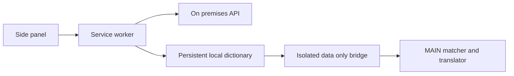

# Architecture Overview

## Files

- manifest.json injects dictionary-bridge.js into ISOLATED and dictionary-terms.js, dictionary.js, translator.js, content.js and caption.js into MAIN on Udemy. Its storage and unlimitedStorage permissions support the persistent dictionary and pending overlays.
- sync-core.js owns persistent dictionary state, normalization, version comparison and local overlays. background.js owns trusted mutations, server calls and targeted tab notifications.
- editor/index.html and editor/app.js provide local editing, login and explicit conflict controls. editor/term-files.js supplies shared validation and legacy conversion helpers.
- translator.js owns one on device English to Korean translator and cache. dictionary.js protects and restores terms. content.js and caption.js render quizzes and captions.
- tools/build-dictionary.js and the dictionary branch workflow remain legacy migration utilities; the extension no longer invokes the native helper.

## Dictionary Sync

The worker downloads server data and stores it in trusted chrome.storage.local alongside local overlays. Account tokens stay in trusted session storage; passwords are never persisted. The isolated bridge gives the page effective terms only. See [Dictionary Sync](../design/translation/30-dictionary-sync.md).

## Translation Flow

The first successful synchronization gates translation. Afterwards the worker can supply saved terms offline. Chrome model availability is a separate requirement. Local changes reconfigure matching and clear cached translations without sending quiz or caption text to the dictionary server.

## Caption Flow

caption.js reuses the same translation core for visible cues. It hides original cues only while the Korean overlay is shown. See [Live Caption](../design/caption/10-live-caption.md).

## Example Scenario

- Input: An initialized device opens a quiz while the server is unavailable.
- Steps: Worker provides saved terms through the bridge and the page uses its existing Chrome model.
- Expected result: Translation works and pending uploads wait for connectivity.
