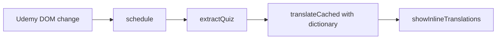
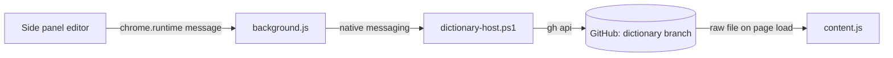

# Architecture Overview

## Files
- `manifest.json` — Manifest V3. Injects the content script into Udemy pages in the `MAIN` world.
- `dictionary-terms.js` — Developer term list, loaded first. Sets `window.__udemyQuizTranslatorTerms`.
- `dictionary.js` — Builds the term matcher. Sets `window.__udemyQuizTranslatorDictionary` (`protect`, `restore`, `configure`).
- `dictionary.json` (on the `dictionary` branch, not on `main`) — Terms (version 2) loaded on each page load. Written by `editor/index.html`.
- `editor/index.html`, `editor/app.js` — The dictionary editor. In the side panel it registers `dictionary.json`; on GitHub Pages it is read-only.
- `editor/setup.html`, `editor/setup.js` — One-time registration guide tab, opened by the editor.
- `background.js` — Service worker. Opens the side panel on the toolbar icon and holds the native messaging port to the helper.
- `tools/dictionary-host.ps1` — Helper on the user's PC (native messaging host). Installs GitHub CLI and opens the login window on request; commits or opens pull requests through `gh api`.
- `tools/register.ps1` — One-time registration of the helper with Chrome.
- `content.js` — Single IIFE. Detects the quiz, translates it with the Chrome Translator API, and renders the result.

## Translation Flow
A `MutationObserver` watches the Udemy page. On change, `update()` extracts the
current quiz, translates the question and each answer, and inserts the Korean text
next to the original elements: to the right when there is room, otherwise below. There is no panel or button on the page.

Scenario:
- Input: User moves from Question 3 to Question 4
- Steps: Observer fires → `extractQuiz()` returns question 4 → translated → old inline nodes removed, new ones inserted
- Result: Korean text for question 4 appears under the original question and each answer

## Dictionary Sync
- Each page load fetches `dictionary.json` from the `dictionary` branch and falls back to the bundled list. See [Dictionary Sync](../design/translation/30-dictionary-sync.md)
- Writing: side panel editor → `background.js` (native port) → `tools/dictionary-host.ps1` → `gh api` → a commit on `dictionary` (owner) or a pull request (others). See [Register Chain](../design/translation/30-dictionary-sync.md#register-chain)

## Modules Inside content.js
- Startup — `autoStart()`, `startOnFirstGesture()`, `initialize()`; see [Startup](../design/translation/10-startup.md)
- Inline rendering — `showInlineTranslations()`, `shiftForSide()`, `showSideTranslations()`, `positionSide()`, `clearInlineTranslations()`; see [Inline Translation](../design/quiz/10-inline-translation.md)
- Extraction — `extractQuiz()`, `cardOf()`, `originalInnerText()`
- Translation — `translateCached()`, `translateWithDictionary()`; see [Dictionary](../design/translation/20-dictionary.md)
