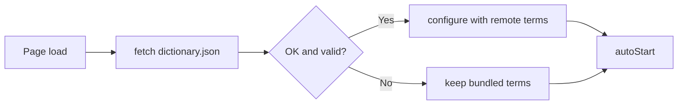
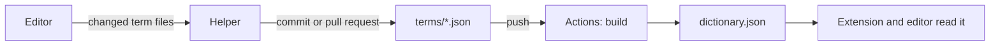
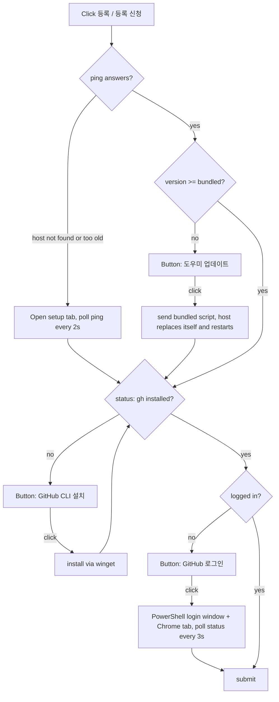

> Archived 2026-11-14: Replaced by on premises dictionary synchronization. See [Current document](../../../design/translation/30-dictionary-sync.md).

# Dictionary Sync Design

## Load and Register
- Input: `GLOSSARY_URL` (raw `dictionary.json` on the `dictionary` branch); editor rows and the GitHub contents API
- Output: `configure(rows)` on the dictionary matcher; a commit on the `dictionary` branch
- Code: `translator.js` → `loadGlossary()`, `isValidTerms()`; `dictionary.js` → `configure()`; `editor/app.js` → `load()`, `submit()`
- Spec: [Dictionary Sync](../../specs/translation/30-dictionary-sync.md#requirements)
- Architecture: [Overview](../../architecture/10-overview.md#dictionary-sync)

Steps:
1. `loadGlossary()` fetches the raw file with `cache: "no-store"` and a 3 second abort timeout
2. The response must be OK JSON with `version` 2 and a valid `terms` array (`isValidTerms()`)
3. `configure(terms)` replaces the bundled list entirely
4. On any failure the bundled list stays in use and a warning is logged
5. `autoStart()` runs after step 4, and every translation awaits the load, so the first quiz or caption translation uses the loaded terms

Representative scenario:
- Input: Remote `terms` = `[{ "word": "private subnet", "meaning": "프라이빗 서브넷" }]`
- Steps: `loadGlossary()` → `isValidTerms()` true → `configure()` → `protect()` on "a private subnet"
- Result: Translation contains `프라이빗 서브넷`
- All scenarios: [Dictionary Sync Scenarios](../../testing/scenarios/translation/30-dictionary-sync.md#dictionary-sync-scenarios)

## Term Files
- Input: A term `{ word, meaning?, exact? }`
- Output: Its file `terms/<slug>-<hash>.json` on the `dictionary` branch, and `dictionary.json` rebuilt from all term files
- Code: `editor/term-files.js` → `fileName()`, `fileContent()`, `blobSha()`, `checkTerm()`, `buildDictionary()`; `tools/build-dictionary.js` (`build`, `split`, `verify`); `.github/workflows/build-dictionary.yml`
- Spec: [Dictionary Sync](../../specs/translation/30-dictionary-sync.md#requirements)
- Architecture: [Overview](../../architecture/10-overview.md#dictionary-sync)

Steps:
1. `fileName(word)`: lowercase slug of the word (letters and digits, up to 40 characters, `term` when none) plus the first 8 hex digits of SHA-1 over the exact word. "SAM" and "sam" get different files even on a case-insensitive file system; the same word always gets the same file
2. `fileContent(term)`: JSON with keys in the order word, meaning, exact; empty meaning and `exact: false` are dropped; ends with a newline. Equal terms always give byte-equal files
3. `blobSha(text)`: git's blob id of that text. The editor uses it as the "loaded version" of a term; the helper compares it with the branch
4. The workflow runs on pushes to `dictionary` that touch `terms/`. It takes the build script from `main`, runs `build`, and commits `dictionary.json` when it changed, retrying on top of the newest commit if another push landed. Pull requests to `dictionary` run the same build as a check without committing
5. `build` fails when a file is not valid JSON, has unknown keys, has an invalid word, meaning, or `exact`, or is not stored under `fileName(word)`

- Scenario: `IAM role` → `terms/iam-role-e952f562.json` → after the push, the workflow rebuilds `dictionary.json` with the row
- Conversion: the existing `dictionary.json` was split once with `split`; `verify` checks that every row comes back unchanged and the rebuilt file is byte-identical
- All scenarios: [Term File Scenarios](../../testing/scenarios/translation/30-dictionary-sync.md#term-file-scenarios)

## Editor
- `editor/index.html` is a single static page, opened in the extension's side panel. It reads `dictionary.json` from the branch and shows the rows in a spreadsheet-style table: 단어, 뜻, 대소문자 구분 (checkbox), with a row number column
- Each row is one term. Edits change the row in memory; the table is rebuilt only for add, delete, sort, and search, so the cell being typed in keeps its focus
- Enter moves to the same column in the next row. Pasting tab-separated text (word, meaning, Y) into a cell inserts one row per line after the current row
- Headers sort the table. The search box filters by word or meaning
- The table shows 50, 100 (default), or 200 rows per page. Searching, sorting, and adding a term return to page 1
- The layout uses only the width its content needs (`fit-content`)
- Leading and trailing spaces are removed when a cell or the new-term box loses focus (`change` → `trimInput()`), not on each keystroke, so spaces inside a term can be typed. See [Edge Spaces Trimmed in the Editor](../../testing/scenarios/translation/30-dictionary-sync.md#edge-spaces-trimmed-in-the-editor)
- Duplicate or empty words are highlighted and block registration
- The commit message lists added, changed, and removed words
- Submit (`buildChanges()`) sends one entry per added, changed, or removed word: its path, its new file content (null for a removal), and `base`, the blob id of the file as loaded (null for a new word)
- A `conflicts` answer opens `editor/conflict.html` in a popup window through `editor/conflicts.js` → `askConflicts()`. The window shows 내 값 and 최신 값 per term. `resolveConflict()` sets the snapshot of each term to the branch's value; 최신 값 also puts that value in the table. Submit then runs again, so the next check compares against the branch's value. Closing the window cancels
- Outside the extension (for example opened as a file) the editor is read-only: the button stays disabled and the status line says registering is in the side panel

## Register Chain
- Input: The edited rows; a click on 등록 / 등록 신청
- Output: A commit on `dictionary` (owner) or a pull request (others), shown in the status line
- Code: `editor/app.js` → `startChain()`, `continueFromStatus()`, `approveInstall()`, `approveLogin()`, `submit()`, `onRegisterClick()`; `background.js` → `connect()`, `ask()`, `stop()`
- Spec: [Dictionary Sync](../../specs/translation/30-dictionary-sync.md#requirements)
- Architecture: [Overview](../../architecture/10-overview.md#dictionary-sync)

- `step` holds what the button shows: `""` (등록 / 등록 신청), `busy`, `register`, `update`, `install`, `login`, `waitLogin`. A click on `update`, `install`, or `login` resumes the chain; on `register` it reopens the guide tab
- Version check (`isCurrentHost()`): the expected version is read from the helper script bundled in the extension (`tools/dictionary-host.ps1`, line `$HostVersion = N`, fetched with `chrome.runtime.getURL`). A `ping` answer without a version counts as 0
- Update (`approveUpdate()`): sends the bundled script in an `update` request, disconnects, and pings again to confirm the new version before continuing
- Too old to update (`registerThenContinue(id, true)`): a helper that answers `Unknown request.` to `ping` or `update` predates these requests. The guide tab opens; the editor and the tab stop the running helper before each `ping`, because a running process keeps its old code, and wait until a helper of the bundled version answers
- `chainId` is incremented by 취소 and 도우미 끄기, so a waiting loop ends instead of continuing an abandoned chain
- The rows are read at submit time, so edits made while the chain waited are included
- The button reads 등록 until the helper has reported the push permission once; after that, 등록 (owner) or 등록 신청 (others). The last known login and permission are kept in the page's `localStorage` only for this label. The helper decides between a commit and a pull request at submit time, so the label never changes what happens
- Scenario: First click on a new PC by a non-owner → button 등록 → chain → status says no push permission → 등록 신청 중... → 등록 신청 완료; the next visit shows 등록 신청
- Scenario: Clean PC, helper registered, no GitHub CLI → click 등록 신청 → button GitHub CLI 설치 → click → installed → button GitHub 로그인 → click → login window and tab → approved → pull request opened without another click
- All scenarios: [Dictionary Sync Scenarios](../../testing/scenarios/translation/30-dictionary-sync.md#register-chain-scenarios)

## Contributor Conflicts
- Input: The contributor's open pull requests on `dictionary`
- Output: A line per pull request that GitHub can no longer merge, with 충돌 해결
- Code: `editor/app.js` → `checkProposals()`, `showProposals()`, `resolveProposal()`; helper `proposals`, `updateProposal`
- Steps: When the panel opens and the saved role is a contributor, `proposals` lists the user's open `dictionary-update-*` pull requests with GitHub's `mergeable`. For a conflicted one, each term file it changes comes with its own value, the branch's value, and `conflict` (the branch changed the file since the pull request's parent commit). 충돌 해결 shows only the conflicted terms in the window; the others keep the contributor's value. `updateProposal` builds a new commit on the newest branch and force-moves the fork branch, or closes the pull request when every file already equals the branch
- Scenario: Y's pull request changes `agent` to 에이전트; the owner then registers `agent` as 대리자 → the panel shows 등록 신청 #12 with 충돌 해결 → Y picks 최신 값 → nothing is left → the pull request is closed with a comment

## Helper
- Code: `tools/dictionary-host.ps1` (native messaging host), `tools/register.ps1` (one-time registration), `editor/setup.html` and `editor/setup.js` (guide tab), `background.js` (port)
- Transport: Chrome native messaging (`nativeMessaging` permission). `background.js` holds the port, so the helper outlives the side panel; an open native port also keeps the service worker alive. Chrome closes the port, and the helper exits, when the extension stops or Chrome exits
- Requests, one at a time: `ping` (registration check and `$HostVersion`, no GitHub call), `update` (writes the script the extension sends over its own file with a UTF-8 BOM, then exits after answering; a text without a `$HostVersion = N` line is rejected), `status` (`gh` found, `gh api user` login, push permission), `install` (`winget install GitHub.cli`), `login` (a PowerShell window running `gh auth login --web` with `GH_BROWSER` set to a no-op, because the editor opens github.com/login/device in a Chrome tab), `submit`
- `submit` checks each change (path `terms/<slug>-<hash>.json`, a valid term or a removal, `base` a blob id or null) and then uses only `gh api`:
  - Reads the head of `dictionary` and the blob id of every term file in one recursive tree call (`Get-TermState()`)
  - `Compare-Changes()`: a file that already has the new content is dropped; a file whose blob id differs from `base` is a conflict and comes back with the branch's content; the rest are pending. Any conflict ends the request without writing
  - Owner: one commit with only the pending files on top of the head (`git/trees` with `base_tree`, then `git/commits`), then moves `dictionary` without force. If another push landed in between, the move is refused and the whole check runs again, up to 3 times
  - Others: `POST forks`, waits for the fork, makes the same commit on the fork, creates `dictionary-update-<ms>` there, and opens the pull request
- `proposals` and `updateProposal`: see [Contributor Conflicts](#contributor-conflicts)
- Registration (`register.ps1`, ASCII only so it runs through `irm | iex`): saves the host and a launcher to `%USERPROFILE%\.udemy-dictionary-helper` and writes the registry key `HKCU\Software\Google\Chrome\NativeMessagingHosts\com.udemy.dictionary_helper`. The launcher runs `powershell.exe -File "%~dp0dictionary-host.ps1"`, so a non-ASCII user folder name never goes into the ASCII batch file. It installs nothing
- `dictionary-host.ps1` is saved with a UTF-8 BOM. Windows PowerShell 5.1 reads a file without one in the system code page, which breaks its Korean login messages
- `$HostVersion` must be raised whenever a request or an answer changes; otherwise registered PCs keep a helper that does not match the editor
- Scenario: Installed v1, extension bundles v2 → `ping` answers 1 → 도우미 업데이트 → `update` → the host writes v2 and exits → next `ping` answers 2 → the chain continues
- stdout carries the protocol, so the host writes diagnostics to stderr and discards every other output
- Scenario: User folder `C:\Users\シンジョンス` → `register.ps1` → the launcher holds only `%~dp0` → `ping` and `status` answer through Chrome's launch path

## Known Limits
- The editor loads `dictionary.json`, which can lag the term files by up to a minute (Actions) plus raw GitHub caching. A term edited from such a stale view shows up as a conflict, never as a silent overwrite
- The pull request check runs on a fork only after the owner approves the first workflow run of a new contributor
- Re-registering through `irm | iex` downloads the helper from `main`. Until `main` has the version the extension bundles, a too-old helper on another PC cannot be replaced that way
- The pull request path (fork, branch, pull request) has not been run end to end yet, because the owner's account cannot fork its own repository
- The Udemy page's Content Security Policy may block the cross-origin `fetch`. This is not yet verified on a Udemy page. If it is blocked, the bundled list is used and a warning is logged
- The remote file replaces the bundled list as a whole; the bundled list is used only when the remote file is unavailable
