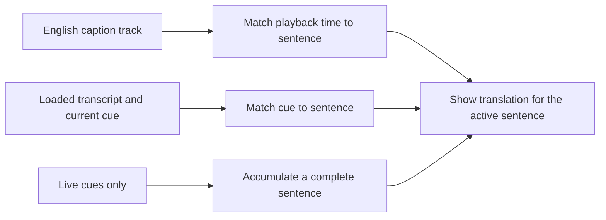

# Live Caption Design

## Caption Translation

- **Input** — English caption cues from the video track, or the transcript panel and current captions on the page.
- **Output** — A Korean sentence overlay, with the corresponding complete English sentence above it when enabled.
- **Code** — `sentences.js` splits text and maps sentences back to cues. `caption.js` selects the active sentence and prepares the following three. The shared `translator.js` applies the dictionary.
- [Live Caption Spec](../../specs/caption/10-live-caption.md)
- [Architecture](../../architecture/10-overview.md#caption-flow)
- [Live Caption Test Cases](../../testing/test-cases/caption/10-live-caption.md)

The extension uses an English video text track when one is available. For Udemy players that expose captions through page elements, it reads the loaded transcript and matches the current caption to one of its rows. The matching row selects the same sentence for every cue from its first to its last row. The last row leaving the video clears the overlay if no new caption has appeared. Without a matching transcript, the extension collects live captions until it sees a complete sentence.

### Representative Scenario

- **Input** — A transcript sentence spans cues A, B and C, with cue B active.
- **Steps** — Match B against the transcript and translate the sentence containing it.
- **Result** — The full A–C translation is visible through C. If translation finishes sooner on a replay, the same translation appears from A.
