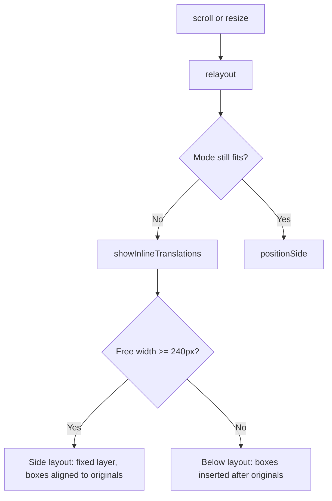

# Inline Translation

## Layout Selection
Translations are shown to the right of the original when there is room, otherwise below it.
- Input: Answer cards, the nearest scroll container of the cards
- Rule: Free width = scroll container right edge (or viewport) − rightmost card edge − 2 × 16px. Side layout when it is at least 240px; box width is capped at 560px
- Code: `content.js` → `showInlineTranslations()`, `sideColumn()`, `scrollParentOf()`
- Architecture: [Overview](../../architecture/10-overview.md#translation-flow)

Representative scenario:
- Input: 1600px wide window, quiz column 640px, curriculum sidebar on the right
- Steps: `sideColumn()` finds free space inside the main scroll container → `showSideTranslations()`
- Result: Each translation floats to the right of its original and stops before the sidebar
- All scenarios: [Inline Translation Scenarios](../../testing/scenarios/quiz/10-inline-translation.md#inline-translation-scenarios)

## Side Layout
- Code: `showSideTranslations()`, `positionSide()`, `relayout()`, `requestRelayout()`
- A `position: fixed` layer (`.uqt-side-layer`, marked with `data-udemy-quiz-inline`) is clipped to the visible part of the scroll container, so boxes never cover a sidebar or the page header
- Each box's top follows its original (`getBoundingClientRect().top`). When a box is taller than its original, the next box is pushed down 8px below it
- Scroll (capture) and resize events reposition boxes once per animation frame
- The Udemy DOM structure is not changed. Text color, font family, and font size are copied from the first card

## Below Layout
- Input: `quiz` from `extractQuiz()`, translated question, translated answers
- Output: `.udemy-quiz-inline-translation` elements inserted into the Udemy DOM, each marked with `data-udemy-quiz-inline`
- Code: `content.js` → `showInlineTranslations()`, `makeInlineTranslation()`, `clearInlineTranslations()`
- Steps: Remove previous inline nodes → insert the question translation before the first card → insert each answer translation after its card
- An `<li>` card gets an `<li>` translation so `<ul>`/`<ol>` stay valid
- Architecture: [Overview](../../architecture/10-overview.md#translation-flow)

## Avoiding Self Detection
Injected nodes must not be read back as quiz text or trigger re-translation.
- `findText()` skips text inside inline nodes
- `originalInnerText()` hides inline nodes while reading `innerText`
- The question range clone removes inline nodes before reading text
- `isOwnMutation()` ignores mutations caused by inline nodes

## Re-insertion
Udemy can replace answer elements with identical text. If the content key is unchanged
but the cards are new, `inlineIsCurrent()` returns false and the cached translations
are inserted again without calling the translator. If the cards are current, the side
boxes are only repositioned, because feedback text can change card heights.

Scenario:
- Input: User selects an answer and Udemy re-renders the cards with the same text
- Steps: Observer fires → same key → `inlineIsCurrent()` false → `showInlineTranslations()` with `lastRendered`
- Result: Translations stay visible, no extra translation call
