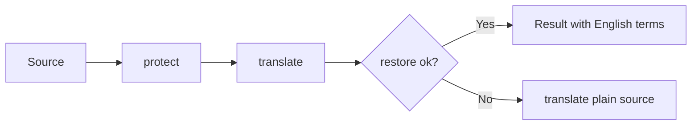

# Dictionary Design

## Placeholder Substitution
- Input: Source English text
- Output: Korean translation with kept terms in their original English form and pairs replaced by their Korean meaning
- Code: `dictionary.js` → `protect()`, `restore()`; `content.js` → `translateWithDictionary()`
- Data: `dictionary-terms.js` → `window.__udemyQuizTranslatorTerms` (`groups`, `caseSensitive`, `pairs`); pairs can be replaced at load time from the dictionary branch ([Dictionary Sync](30-dictionary-sync.md))
- Spec: [Dictionary](../../specs/translation/20-dictionary.md#requirements)
- Architecture: [Overview](../../architecture/10-overview.md#translation-flow)

Steps:
1. `protect()` replaces each term with `[[n]]`, in text order, and returns the original surface texts and, for pairs, their meanings
2. The translator translates the text with placeholders
3. `restore()` puts back the meaning for a pair and the English text for a kept term. Extra brackets the translator adds (`[[[0]]`) are absorbed
4. If any placeholder is missing, `restore()` returns `null` and the plain source is translated instead

Representative scenario:
- Input: "Launch an EC2 instance in a private subnet with an IAM role."
- Steps: `protect()` → "Launch an [[0]] [[1]] in a [[2]] with an [[3]]." → translate → `restore()`
- Result: "private subnet에서 EC2 instance를 IAM role과 함께 시작합니다."
- All scenarios: [Dictionary Scenarios](../../testing/scenarios/translation/20-dictionary.md#dictionary-scenarios)

## Placeholder Format
`[[n]]` was chosen after testing on Chrome 157: it survived 15 tokens in a long text. `X0X` and `ZQ0ZQ` were lowercased, and `⟦n⟧` was corrupted. Source text that already contains `[[n]]` is translated without the dictionary.

## Pairs
- `configure(pairs)` rebuilds the matcher from a `word → meaning` map. It runs once at load with `pairs` from the data file, and can be called again to replace the pairs
- Pair keys are compared case-insensitively with collapsed whitespace; a trailing `s`/`es` is removed when the plural itself is not a key
- Precedence when one spelling appears in several sources: `groups` < `caseSensitive` < `pairs`
- Acronym pairs (`SAM`) match case-sensitively, like kept acronyms

## Matching
- One regex for all terms, sorted longest first
- Case-insensitive terms use the inline `(?i:...)` modifier (Chrome 125+; the extension requires 138+)
- Terms without lowercase letters and the `caseSensitive` list match exactly
- Boundaries: no letter, digit, or `_` on either side; spaces in a term match any whitespace
- A trailing `s`/`es` is matched after a term ending in a letter

## Term File Layout
`dictionary-terms.js` has `caseSensitive` (product names that are ordinary words in lowercase) and `groups` (`claude`, `awsServices`, `awsConcepts`, `ccarF`, `general`). `ccarF` is organized by the five CCAR-F exam domains. Adding a term means adding a string to a group. Avoid everyday English words such as "object", "request", "continue", or "summary", which would stay untranslated everywhere. Add inflected forms that are not plurals explicitly ("deterministically").

## Known Limits
Korean particles are chosen by the translator for the placeholder, so after restoring they may not match the English word's pronunciation (e.g. "Claude extended thinking를"). For pairs the meaning replaces the placeholder, so a particle the translator attached to the placeholder (e.g. "은/는") stays after the meaning and may read unnaturally when the meaning ends in a different sound.
