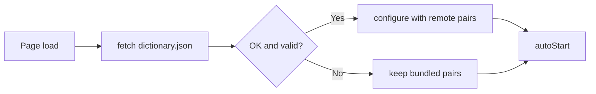

# Dictionary Sync Design

## Load and Register
- Input: `GLOSSARY_URL` (raw `dictionary.json` on the `dictionary` branch); editor `pairs` and the GitHub contents API
- Output: `configure(pairs)` on the dictionary matcher; a commit on the `dictionary` branch
- Code: `content.js` → `loadGlossary()`, `isValidPairs()`; `dictionary.js` → `configure()`; `editor/index.html` → `load()`, `register()`
- Spec: [Dictionary Sync](../../specs/translation/30-dictionary-sync.md#requirements)
- Architecture: [Overview](../../architecture/10-overview.md#dictionary-sync)

Steps:
1. `loadGlossary()` fetches the raw file with `cache: "no-store"` and a 3 second abort timeout
2. The response must be OK JSON with a valid `pairs` object (`isValidPairs()`)
3. `configure(pairs)` replaces the bundled pairs. Kept terms (`groups`, `caseSensitive`) are unchanged
4. On any failure the bundled pairs stay in use and a warning is logged
5. `autoStart()` runs after step 4, so the first translation uses the loaded pairs

Representative scenario:
- Input: Remote `pairs` = `{ "private subnet": "프라이빗 서브넷" }`
- Steps: `loadGlossary()` → `isValidPairs()` true → `configure()` → `protect()` on "a private subnet"
- Result: Translation contains `프라이빗 서브넷`
- All scenarios: [Dictionary Sync Scenarios](../../testing/scenarios/translation/30-dictionary-sync.md#dictionary-sync-scenarios)

## Editor
- `editor/index.html` is a single static page (GitHub Pages). It reads `dictionary.json` from the branch, edits `pairs` in memory, and on 등록 writes the file with `PUT /repos/{repo}/contents/dictionary.json` using the file `sha`
- The commit message lists added, changed, and removed words
- A 409 response means the branch changed; the user reloads and retries (no silent overwrite)
- The token is read from and written to `sessionStorage` only

## Known Limits
- The Udemy page's Content Security Policy may block the cross-origin `fetch`. This is not yet verified on a Udemy page. If it is blocked, the bundled pairs are used and a warning is logged
- Pairs are replaced as a whole by the remote file; bundled pairs are used only when the remote file is unavailable
