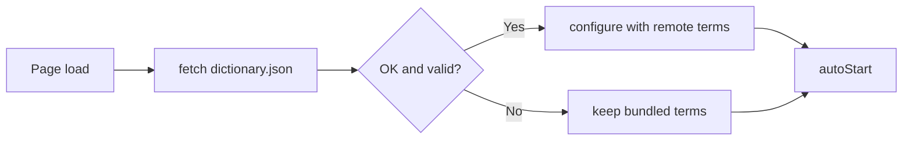

# Dictionary Sync Design

## Load and Register
- Input: `GLOSSARY_URL` (raw `dictionary.json` on the `dictionary` branch); editor rows and the GitHub contents API
- Output: `configure(rows)` on the dictionary matcher; a commit on the `dictionary` branch
- Code: `content.js` → `loadGlossary()`, `isValidTerms()`; `dictionary.js` → `configure()`; `editor/index.html` → `load()`, `register()`
- Spec: [Dictionary Sync](../../specs/translation/30-dictionary-sync.md#requirements)
- Architecture: [Overview](../../architecture/10-overview.md#dictionary-sync)

Steps:
1. `loadGlossary()` fetches the raw file with `cache: "no-store"` and a 3 second abort timeout
2. The response must be OK JSON with `version` 2 and a valid `terms` array (`isValidTerms()`)
3. `configure(terms)` replaces the bundled list entirely
4. On any failure the bundled list stays in use and a warning is logged
5. `autoStart()` runs after step 4, so the first translation uses the loaded terms

Representative scenario:
- Input: Remote `terms` = `[{ "word": "private subnet", "meaning": "프라이빗 서브넷" }]`
- Steps: `loadGlossary()` → `isValidTerms()` true → `configure()` → `protect()` on "a private subnet"
- Result: Translation contains `프라이빗 서브넷`
- All scenarios: [Dictionary Sync Scenarios](../../testing/scenarios/translation/30-dictionary-sync.md#dictionary-sync-scenarios)

## Editor
- `editor/index.html` is a single static page (GitHub Pages). It reads `dictionary.json` from the branch and shows the rows in a spreadsheet-style table: 단어, 뜻, 대소문자 구분 (checkbox), with a row number column
- Each row is one term. Edits change the row in memory; the table is rebuilt only for add, delete, sort, and search, so the cell being typed in keeps its focus
- Enter moves to the same column in the next row. Pasting tab-separated text (word, meaning, Y) into a cell inserts one row per line after the current row
- Headers sort the table. The search box filters by word or meaning
- The table shows 50, 100 (default), or 200 rows per page. Searching, sorting, and adding a term return to page 1
- The layout uses only the width its content needs (`fit-content`)
- Duplicate or empty words are highlighted and block registration
- On 등록 (or PR 제안 for users without push permission) the editor posts the file and the commit message to the local helper (`POST /submit`). Rows are sorted by word, and empty meanings are omitted
- The helper (`tools/dictionary-helper.js`) commits directly for a user with push permission, or forks, commits to a new branch, and opens a pull request with `gh pr create`. It runs git and gh without a shell, one request at a time
- The editor holds no token. On load it calls `GET /health`, which reports the gh login and push permission; the button reads 등록 or PR 제안 accordingly. Without the helper, the setup panel is shown and the file can be copied (JSON 복사)
- The commit message lists added, changed, and removed words
- The helper pulls the branch before committing. A conflicting change is reported as an error instead of being overwritten

## Known Limits
- The Udemy page's Content Security Policy may block the cross-origin `fetch`. This is not yet verified on a Udemy page. If it is blocked, the bundled list is used and a warning is logged
- The remote file replaces the bundled list as a whole; the bundled list is used only when the remote file is unavailable
