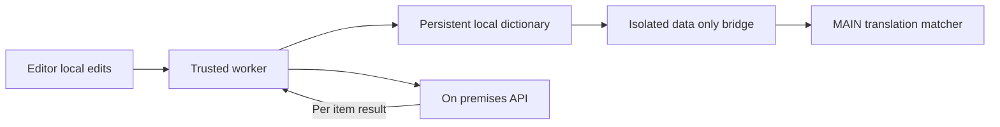

# Dictionary Sync Design

- Spec: [Dictionary Sync](../../specs/translation/30-dictionary-sync.md)
- Architecture: [Overview](../../architecture/10-overview.md)
- Scenarios: [Dictionary Sync Scenarios](../../testing/scenarios/translation/30-dictionary-sync.md)

## Persistent State

- Input: Version 2 snapshots with revision and items containing word, revision and value or null tombstone; edits and explicit resolution choices.
- Output: Persisted effective local terms and independent item upload results.
- sync-core.js exposes initial, normalizeTerm, validateSnapshot, download, item, effective, edit, request, accept, resolved and clone through DictionarySync or CommonJS.
- State schema 1 includes initialized, revision, items, drafts, autoUpload and downloadedAt. A draft retains its original baseRevision, stable requestId and localRevision, plus pending, conflict or local mode.
- Downloads never silently rebase unsent edits. accept checks localRevision so an old acknowledgement cannot erase a newer edit. Older server snapshots are rejected.
- background.js serializes cloned state mutations, persists before acknowledgement, and retries requests with stable IDs. Passwords are never stored. Dictionary state uses trusted chrome.storage.local; account tokens use trusted chrome.storage.session.

## Network And Page Bridge

- API base is https://api.jace-s.com/udemy-translator. Website connect and worker session, logout, dictionary, upload and conflict resolution calls reuse the platform contract. Worker authenticated calls explicitly send Bearer and CSRF with cookies omitted.
- call uses a 10 second timeout. download coalesces requests and throttles automatic checks for 5 seconds; explicit refresh bypasses that throttle. The one minute alarm retries uploads.
- editorAction, login, resolve and view accept trusted editor messages only. Page messages can request dictionary data, never editing or account operations.
- dictionary-bridge.js runs ISOLATED, handles data only requests, online restoration and worker notifications. translator.js runs MAIN and waits for an initialized bridge response, then reconfigures matching and clears translation cache on local changes.
- manifest.json uses sidePanel, storage, unlimitedStorage and alarms; API access permits server calls, and Udemy host access permits targeting data updates to its tabs. unlimitedStorage supports the full bounded dictionary plus unsent overlays and versioned deletion records without the default 10 MB local quota. See [Chrome storage documentation](https://developer.chrome.com/docs/extensions/reference/api/storage#storage-areas), verified 2026 November 14. Native messaging and GitHub CLI are no longer used by the extension.

## Conflict And Editor Modules

- Conflicts pause only their own draft. Explicit choices are queued durably with a separate request ID, including offline choices. Mine rechecks concurrency; later clears the outgoing resolution request but stays paused; local only retains the overlay and excludes uploads.
- editor/app.js reuses editor/term-files.js normalization and validation. It implements the existing table, pagination, search, sorting, paste and Enter movement. A cell commits on Enter or leaving it; additions persist immediately.
- Rename saves the new entry before removing the old name. Conflicted rows wait for resolution. Unchanged conflict controls are not recreated during background updates, and disclosure state survives relevant refreshes.
- editor/index.html adds website session connection, automatic upload, manual upload, the four resolution choices and an explicit share again action for local only items. Hidden login controls remain hidden under author CSS.

## Representative Scenario

- Input: Local course baseline 10, server course revision 12 and a different proposed local meaning.
- Steps: Upload returns a logged conflict, show both meanings and the last server writer and time, then resolve mine against 12.
- Expected result: Store the selection only if 12 is still current; otherwise retain the newer server value and show another conflict. Independent terms continue.

## Website Login

The editor has a site account login button, not password fields. The worker opens the first party /translator-connect page with a random pending challenge and its extension ID. Existing website login, including Google, is reused. The page receives a connection envelope through cookie and CSRF protected POST connect and delivers it directly through Chrome external messaging.

finishConnection accepts only jace-s.com or www.jace-s.com at that exact connection path, the pending ten minute challenge and originating tab. It verifies the server session, saves only trusted session credentials and consumes the challenge before starting authorized uploads. Manifest externally_connectable allows these first party pages only. Replays and invalid challenges fail. Tokens are never in the URL.

Local edits may be saved before login and initial download. The first successful dictionary download is still required before translation. No other account receives permissions merely to enable Google login.
